# Data model

Source of truth: `backend/prisma/schema.prisma` plus the raw-SQL migration `backend/prisma/migrations/*_db_constraints`.
This page explains the shape and the rules Prisma cannot express.

## Conventions
- Tables are PascalCase (`"Drawing"`), columns camelCase (`"pricePaise"`) — Prisma defaults. **Raw SQL must quote identifiers.**
- IDs are `uuid` generated by Postgres (`gen_random_uuid()`).
- Money is integer **paise** (`Int`). Plot lengths are **feet**; `plotAreaSqft` is derived.
- Timestamps are `timestamp(3)` (UTC); `updatedAt` is maintained by Prisma.

## ER diagram

```mermaid
erDiagram
  User ||--o{ RefreshToken : has
  User ||--o{ PasswordResetToken : has
  User ||--o{ VerificationRequest : submits
  User ||--o{ CategoryRequest : requests
  User ||--o{ Drawing : authors
  User ||--o{ Purchase : buys
  User ||--o{ Review : writes
  User ||--o{ DrawingView : views
  User ||--o{ Interest : marks
  User ||--o{ Favorite : saves
  User ||--o{ CartItem : carts
  User ||--o{ FreeDownload : claims
  User ||--o{ LedgerEntry : "wallet owner"
  User ||--o{ Withdrawal : requests
  User ||--o| BankAccount : owns
  User ||--o{ AuditLog : acts
  BankAccount ||--o{ Withdrawal : "paid to"
  Category ||--o{ Drawing : groups
  Drawing ||--o{ DrawingSheet : contains
  Drawing ||--o{ Purchase : sold
  Drawing ||--o{ Review : reviewed
  Drawing ||--o{ DrawingView : viewed
  Drawing ||--o{ Interest : interest
  Drawing ||--o{ Favorite : favorited
  Drawing ||--o{ CartItem : carted
  Drawing ||--o{ FreeDownload : downloaded

  User {
    uuid id PK
    string email UK
    string passwordHash
    enum role "ARCHITECT | ADMIN"
    enum verificationStatus "PENDING | APPROVED | REJECTED"
    float architectRating
    int architectRatingCount
    int freeDownloadsUsed
  }
  RefreshToken {
    uuid id PK
    uuid userId FK
    uuid familyId "rotation family"
    string tokenHash UK "SHA-256"
    datetime expiresAt
    datetime revokedAt
    uuid replacedById
  }
  PasswordResetToken {
    uuid id PK
    uuid userId FK
    string tokenHash UK
    datetime expiresAt
    datetime usedAt
  }
  VerificationRequest {
    uuid id PK
    uuid userId FK
    string coaRegistrationNumber
    string documentKey
    enum status
    uuid reviewerId FK
  }
  Category {
    uuid id PK
    string name UK
    string slug UK
    bool isActive
  }
  CategoryRequest {
    uuid id PK
    uuid userId FK
    string requestedName
    enum status
  }
  Drawing {
    uuid id PK
    uuid architectId FK
    uuid categoryId FK
    string title
    string description
    string city
    float plotLengthFt
    float plotBreadthFt
    float plotAreaSqft "trigger-maintained"
    int floors
    enum facing
    int pricePaise
    enum status "DRAFT|PROCESSING|PUBLISHED|UNDER_REVIEW|REMOVED|FAILED"
    string failureReason
    float avgRating
    int ratingCount
    int viewCount
    int purchaseCount
    tsvector searchVector "generated"
  }
  DrawingSheet {
    uuid id PK
    uuid drawingId FK
    enum type
    string originalKey
    string originalMime
    string fileName
    int sizeBytes
    bool isPreview
    string previewKey
    string pHash
    string sha256
  }
  Purchase {
    uuid id PK
    uuid buyerId FK
    uuid drawingId FK
    int pricePaise
    int platformFeePaise
    enum status "CREATED|PAID|FAILED|REFUNDED"
    string razorpayOrderId
    string razorpayPaymentId
    datetime paidAt
  }
  FreeDownload {
    uuid userId PK
    uuid drawingId PK
  }
  Review {
    uuid id PK
    uuid buyerId FK
    uuid drawingId FK
    int rating "1..5"
    string comment
  }
  DrawingView {
    uuid id PK
    uuid drawingId FK
    uuid viewerId FK
    datetime viewedAt
  }
  Interest {
    uuid userId PK
    uuid drawingId PK
  }
  Favorite {
    uuid userId PK
    uuid drawingId PK
  }
  CartItem {
    uuid userId PK
    uuid drawingId PK
  }
  LedgerEntry {
    uuid id PK
    uuid txnId "groups a balanced txn"
    enum accountType
    uuid accountOwnerId FK
    int amountPaise "signed"
    enum entryType
    string referenceId
  }
  BankAccount {
    uuid id PK
    uuid userId FK
    string holderName
    string ifsc
    string accountNumberLast4
    string providerFundAccountId
  }
  Withdrawal {
    uuid id PK
    uuid userId FK
    uuid bankAccountId FK
    int amountPaise
    enum status "REQUESTED|PROCESSING|PAID|FAILED"
    string providerRef
    string failureReason
  }
  ProcessedWebhookEvent {
    string provider PK
    string eventId PK
    string eventType
  }
  AuditLog {
    uuid id PK
    uuid actorId FK
    string action
    string entityType
    string entityId
    json metadata
  }
```

## Rules enforced in the database (raw SQL migration)

| Rule | Mechanism |
|---|---|
| One PAID purchase per (buyer, drawing); CREATED/FAILED/REFUNDED may repeat | partial unique index `Purchase_buyerId_drawingId_paid_key … WHERE status = 'PAID'` |
| One review per (buyer, drawing) | unique `(buyerId, drawingId)` |
| `rating` 1..5, `pricePaise >= 0`, plot lengths > 0, `floors >= 1`, `platformFeePaise` between 0 and price, withdrawal amount > 0 | `CHECK` constraints (named `<Table>_<column>_check`) |
| `plotAreaSqft = plotLengthFt * plotBreadthFt` | `BEFORE INSERT/UPDATE` trigger `set_drawing_plot_area` — never write the column from the app |
| Full-text search on title (weight A) + description (weight B) | `searchVector` is a `GENERATED ALWAYS … STORED` tsvector with a GIN index; query with `"searchVector" @@ plainto_tsquery('english', $1)` and rank with `ts_rank` |
| Ledger is append-only | triggers reject `UPDATE`/`DELETE` on `LedgerEntry` |
| Every ledger `txnId` sums to 0 | **deferred constraint trigger** `LedgerEntry_balanced_trg` (function `ledger_assert_balanced`) checks `SUM("amountPaise")` per txn at commit; `USER_WALLET` rows must have an owner (`CHECK`) |
| Webhook idempotency | `ProcessedWebhookEvent` PK `(provider, eventId)`: insert first, skip on unique violation |

## Ledger
Double-entry, signed integer paise: credits positive, debits negative, every `txnId` sums to zero. Post only through
`LedgerService.postTransaction(entries, tx?)` (rejects unbalanced input before any write; pass `tx` to commit atomically
with the caller's other writes). A wallet balance is `SUM(amountPaise)` over that user's `USER_WALLET` entries
(`LedgerService.getWalletBalance`). Because the ledger is append-only, corrections are new reversing transactions.

Example sale of ₹499 (49900 paise), 10% platform fee:

| account | amountPaise | entryType |
|---|---|---|
| PAYMENT_GATEWAY | -49900 | SALE |
| USER_WALLET (architect) | +44910 | SALE |
| PLATFORM_REVENUE | +4990 | PLATFORM_FEE |

## Notable modelling choices
- `FreeDownload (userId, drawingId)` records free claims: it backs the `FREE_DOWNLOAD_LIMIT` quota and entitles the user to review a free drawing.
- `User.freeDownloadsUsed`, `Drawing.avgRating/ratingCount/viewCount/purchaseCount` and `User.architectRating(+Count)` are denormalised counters kept up to date by the services that change the underlying rows.
- `DrawingSheet.sha256` / `pHash` are filled by the processing pipeline (Phase 3) and used by the plagiarism check (Phase 8).
- `RefreshToken` stores only a SHA-256 hash; all tokens from one login share `familyId` so reuse of a rotated token revokes the family.
- Test DB: `npm run test:e2e` runs `prisma migrate deploy` against `sketchsquare_test` (global setup) and `resetDb()` truncates between specs.

## Search indexes and EXPLAIN notes
Search (`GET /drawings/search`) only reads `Drawing WHERE status='PUBLISHED'`. Indexes serving it: `Drawing_plotLengthFt_plotBreadthFt_idx` (size BitmapOr for both orientations), `searchVector` GIN (full-text), and the partial indexes from migration `20261017100100_search_indexes` (`lower(city)`, `(avgRating DESC, ratingCount DESC, createdAt DESC, id)`, `(purchaseCount DESC, viewCount DESC, createdAt DESC, id)`).
Measured with `test/perf/search-explain.ts` on 50k synthetic published drawings (`TEST_DATABASE_URL=… npx ts-node test/perf/search-explain.ts 50000`):

| Scenario | Time |
|---|---|
| newest (and deep cursor) | ~0.07 ms |
| size 30x40 ±10 % | ~2 ms (BitmapOr on size index) |
| size + city | ~0.7 ms |
| rating / popularity sorts | 0.06–0.15 ms |
| category + price_asc | ~3.6 ms |
| full-text `villa` (13 % selectivity) | ~12 ms (seq scan; planner prefers it at that selectivity) |
